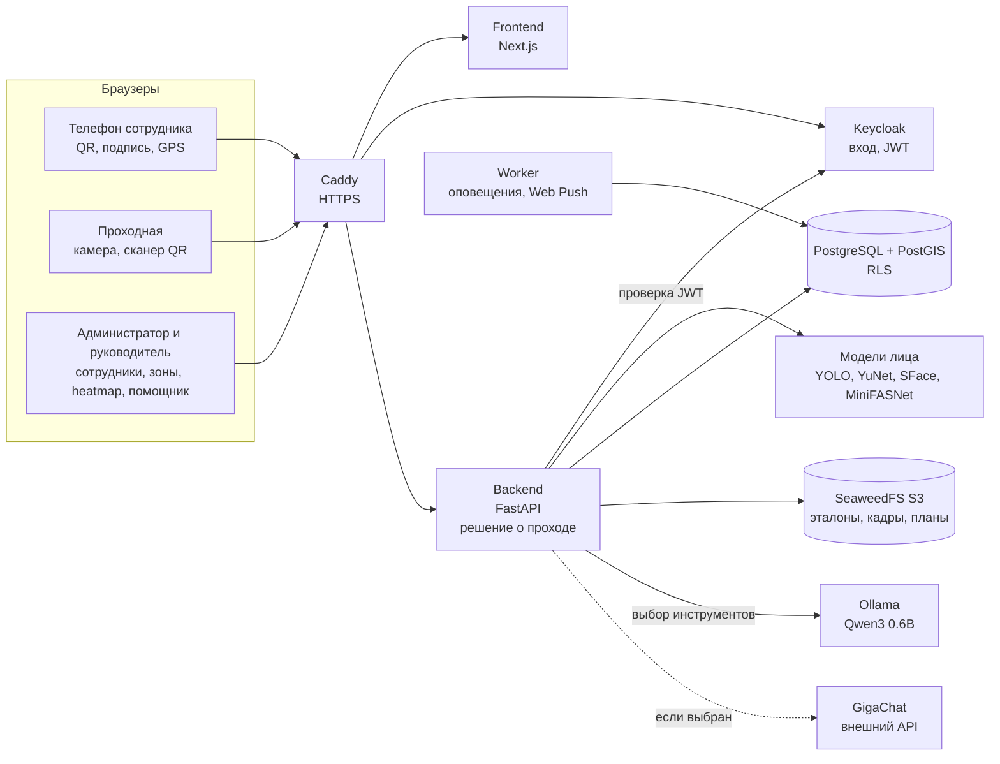
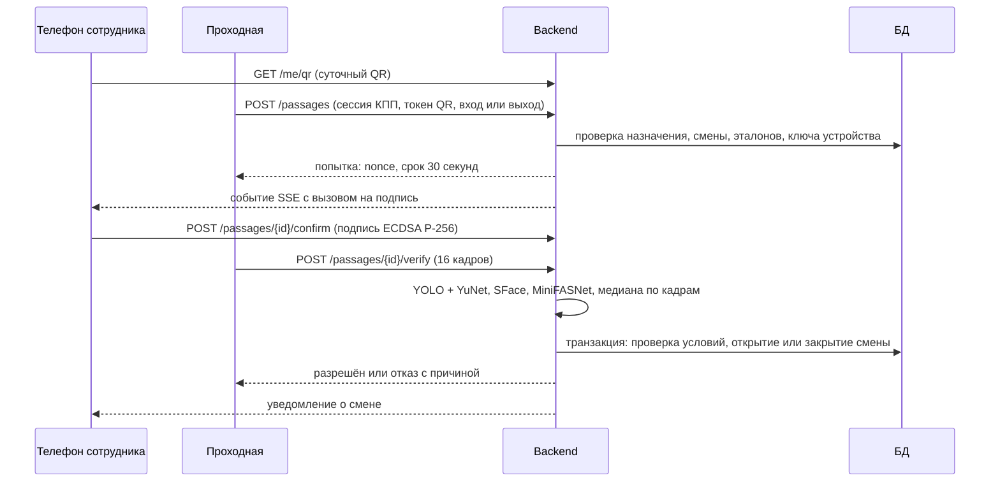

# Схема решения

## Компоненты

Решение о проходе принимает только Backend. Браузеры передают кадры, подпись и координаты, но не результат. Помощник (Ollama или GigaChat) не обращается к БД: SQL выполняет Backend через read-only роль, а числа в ответе берутся из результатов запросов.

Вспомогательные контейнеры при запуске: `secrets` (генерация секретов), `migrate` (схема БД), `provisioner` и `storage-worker` (бакеты и политики S3), `model-init` (загрузка моделей), `llm-init` (загрузка и прогрев Qwen3).

## Проход

Отказ возникает, если не выполнено любое условие: QR отозван или истёк, устройство сброшено, эталоны заменены, телефон не подтвердил, лицо не совпало, живость не пройдена, смена в неподходящем состоянии, истёк срок попытки.

## Смена и геопозиция

После открытия смены телефон передаёт координаты сразу и затем раз в 10 минут (`POST /me/location`). Backend проверяет границу объекта (PostGIS) и зону, помечает подозрительные точки и создаёт оповещение при выходе за границу. Worker создаёт оповещение, если точек нет больше 12 минут. Закрытие смены останавливает передачу, запоздавшие пакеты сервер отклоняет.

## Данные

Таблицы и связи описаны в [architecture.md](architecture.md), раздел «Данные»; источник схемы — [001_schema.sql](../backend/sql/001_schema.sql).
